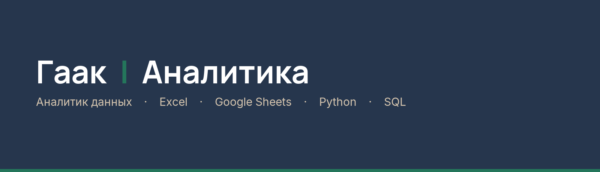
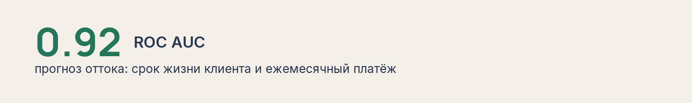

Собираю данные так, чтобы по ним можно было ответить: что происходит и на что это влияет.

## Garmin → Google Sheets

Тренировки и метрики Garmin сами попадают в таблицу бегового дашборда. Если Garmin ответил с ошибкой, уже заполненные ячейки не затираются.

Python · GitHub Actions · Google Sheets

[Открыть проект](https://github.com/data-witch/garmin-gsheets-run-sync)

## Яндекс.Практикум

Учебные проекты в одном репозитории: музыка, кредиты, недвижимость, тарифы, отток и классификация.

Python · Pandas · scikit-learn

[Все проекты](https://github.com/data-witch/Practicum-by-Yandex)

## Навыки

[Сертификаты](https://github.com/data-witch/Sertificate) · [Резюме](https://tomsk.hh.ru/resume/6f9926f8ff101a2a020039ed1f344d38424947?hhtmFrom=profile) · [Telegram](https://t.me/dv_gaak)
